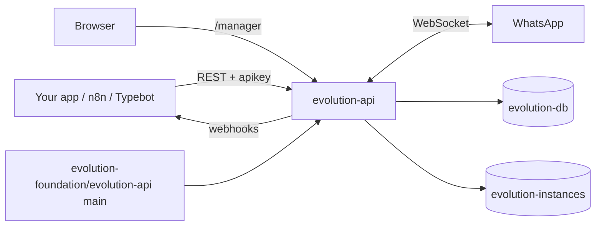

<div align="center">

# Evolution API on Render

A self-hosted WhatsApp API with a web manager, webhooks, and chatbot integrations. This repo is the Blueprint. The app is built from [evolution-foundation/evolution-api](https://github.com/evolution-foundation/evolution-api) `main`.

<p>
  <a href="https://render.com/deploy-template/api/github/start?template_repo=evolution-api">
    
  </a>
</p>

<p>
  <a href="https://render.com">
    
  </a>
  <a href="https://github.com/evolution-foundation/evolution-api">
    
  </a>
  <a href="https://github.com/evolution-foundation/evolution-api/blob/main/LICENSE">
    
  </a>
</p>

</div>

## What This Template Shows

This repository does not contain the Evolution API source. The service sets `repo: https://github.com/evolution-foundation/evolution-api` and `branch: main`, so Render clones upstream and builds its `Dockerfile`. A push to that branch redeploys the service. Plan, disk, and environment changes are commits in this wrapper.

| Piece | Role |
| --- | --- |
| **[Evolution API](https://github.com/evolution-foundation/evolution-api)** | WhatsApp API (Baileys and the official Cloud API), REST endpoints, webhooks, and the Evolution Manager UI at `/manager`. |
| **[Render Web Service](https://render.com/docs/web-services)** | `evolution-api`, Docker runtime. Runs Prisma migrations on boot, then serves on 8080. |
| **[Render Postgres](https://render.com/docs/postgresql)** | `evolution-db`. Instances, session credentials, messages, contacts, and chats. |
| **[Persistent disk](https://render.com/docs/disks)** | `/evolution/instances`. Baileys signal keys for each connected number. |

## Architecture



### How It Works

1. Click **Deploy to Render**. The flow forks this wrapper into your GitHub account and applies [`render.yaml`](./render.yaml).
2. Render creates `evolution-db`, generates `AUTHENTICATION_API_KEY`, and wires the database URL and public URL into the service.
3. Render clones `evolution-foundation/evolution-api` at `main` and builds its `Dockerfile`. On start, the container runs `prisma migrate deploy`, then the server.
4. Open `https://<evolution-api>.onrender.com/manager`, sign in with `AUTHENTICATION_API_KEY`, create an instance, and scan the QR code with WhatsApp.
5. Later commits on upstream `main` redeploy the service. Editing this wrapper changes the Blueprint, not the app source.

| Resource | Type | Plan | Notes |
| --- | --- | --- | --- |
| `evolution-api` | Web, Docker | Starter | Disk at `/evolution/instances`, 1 GB. Health: `/`. Single instance. |
| `evolution-db` | Postgres 16 | Basic 256 MB | Internal connections only. |

Default region: **Oregon**. Nothing to fill in on deploy.

### Why a disk instead of Redis

Evolution API stores each session's `creds` in Postgres and the Baileys signal keys in Redis or on the local filesystem. This Blueprint turns Redis off and mounts a disk where those keys are written. That saves a Key Value instance, and a service with a disk stops the old container before it starts the new one. WhatsApp allows one live socket per session, so overlapping containers during a zero-downtime deploy would fight over the connection.

The trade-off is a short outage on every deploy. Render stops the old container before the new one starts, so the API is unavailable for about a minute and a half while the new container runs migrations and reconnects. Connected numbers come back on their own; no new QR code or pairing code is needed.

### Optional: Key Value for session keys

[`render.yaml`](./render.yaml) ships a commented-out [Key Value](https://render.com/docs/key-value) instance. With it on, the signal keys and Evolution's cache live in Redis instead of on the disk. `creds` stay in Postgres in both modes.

| | Default (disk) | Key Value |
| --- | --- | --- |
| Signal keys | `/evolution/instances` on the disk | `evolution-kv` |
| Cache | In-process, lost on restart | Redis, survives restarts |
| Extra cost | $0 | ~$10 (Starter) |
| Deploys | Stop-then-start | Stop-then-start (the disk stays) |

To turn it on, edit `render.yaml` before your first deploy:

1. Set `CACHE_REDIS_ENABLED` to `"true"` and `CACHE_LOCAL_ENABLED` to `"false"`.
2. Uncomment `CACHE_REDIS_URI` and the `evolution-kv` service.
3. Push, then deploy the Blueprint.

Keep these as they are:

- **The disk.** It no longer holds keys, but it keeps deploys stop-then-start. Without it, Render overlaps the old and new containers. Both connect with the same session, kick each other offline, and write the same keys to Redis at once.
- **A paid plan with `noeviction`.** The free plan has no persistence, and eviction deletes keys under memory pressure. Either one logs your numbers out.
- **`numInstances: 1`.** Key Value does not make horizontal scaling safe.

Switching an existing deploy from disk to Key Value moves the keys, so every connected number must pair again.

## Quick Start

### Prerequisites

- A [Render account](https://dashboard.render.com/register)
- A phone with WhatsApp to scan the pairing QR code

### Deploy

1. Click **Deploy to Render** above.
2. Wait until `evolution-api` is **Live**. The first build takes several minutes.
3. Copy `AUTHENTICATION_API_KEY` from the service's **Environment** page.
4. Open `/manager`, sign in, and create an instance.

```bash
curl -fsS "https://<evolution-api>.onrender.com/"
```

Create an instance from the API instead of the manager:

```bash
curl -X POST "https://<evolution-api>.onrender.com/instance/create" \
  -H "apikey: $AUTHENTICATION_API_KEY" \
  -H "Content-Type: application/json" \
  -d '{"instanceName": "main", "integration": "WHATSAPP-BAILEYS", "qrcode": true}'
```

Send a message once the instance is connected:

```bash
curl -X POST "https://<evolution-api>.onrender.com/message/sendText/main" \
  -H "apikey: $AUTHENTICATION_API_KEY" \
  -H "Content-Type: application/json" \
  -d '{"number": "15551234567", "text": "Hello from Render"}'
```

## Features

| Feature | Description |
| --- | --- |
| **WhatsApp Baileys** | Connect a regular WhatsApp or WhatsApp Business number with a QR code. |
| **WhatsApp Cloud API** | Use Meta's official API with the same REST surface. |
| **Manager UI** | Create instances, scan QR codes, and configure integrations at `/manager`. |
| **Webhooks** | Per-instance or global webhooks for messages, status, and connection events. |
| **Integrations** | Typebot, Chatwoot, OpenAI, Dify, n8n, Flowise, and EvoAI. |
| **Upstream builds** | The service tracks `evolution-foundation/evolution-api` `main` without copying that repo here. |

## Configuration

| Variable | Source | Description |
| --- | --- | --- |
| `AUTHENTICATION_API_KEY` | Auto-generated | Global API key. Also the Manager sign-in. |
| `DATABASE_CONNECTION_URI` | Wired | Internal URL of `evolution-db`. |
| `SERVER_URL` | Wired | The service's `RENDER_EXTERNAL_URL`. Used in webhook payloads and media links. |
| `DATABASE_PROVIDER` | Blueprint | `postgresql`. |
| `PORT`, `SERVER_PORT` | Blueprint | `8080`. The app listens on `SERVER_PORT`. |
| `CACHE_REDIS_ENABLED` | Blueprint | `false`. See [Why a disk instead of Redis](#why-a-disk-instead-of-redis). |
| `CACHE_LOCAL_ENABLED` | Blueprint | `true`. In-process cache. |
| `TELEMETRY_ENABLED` | Blueprint | `false`. |
| `TZ` | Blueprint | `UTC`. The upstream image defaults to `America/Sao_Paulo`. |
| `WEBHOOK_GLOBAL_*`, `OPENAI_ENABLED`, `TYPEBOT_ENABLED`, `CHATWOOT_ENABLED`, `S3_*` | Optional | See [`.env.example`](./.env.example) and the upstream [`.env.example`](https://github.com/evolution-foundation/evolution-api/blob/main/.env.example). |

`generateValue` runs once, on the first Blueprint apply. Any variable you do not set falls back to the upstream `.env.example`, which the image copies to `.env`.

## Cost

Prices from [Render's pricing page](https://render.com/pricing).

| Resource | Approx. monthly |
| --- | ---: |
| `evolution-api` (Starter, 512 MB) | $7 |
| `evolution-db` (Basic 256 MB) | $6 |
| 1 GB disk | $0.25 |
| **Total** | **~$13.25** |
| Optional `evolution-kv` (Key Value Starter) | +$10 |

Starter fits a handful of numbers. Move to Standard if you connect many instances or turn on media storage and history sync.

## Troubleshooting

| Problem | Solution |
| --- | --- |
| Deploy fails with `P1001: Can't reach database server` | The first deploy can start before `evolution-db` is **Available**. Wait for the database, then **Manual Deploy**. |
| Manager rejects the key | Use `AUTHENTICATION_API_KEY` from the service's **Environment** page, not the upstream example key. |
| QR code expires before you scan it | Request a new one with `GET /instance/connect/<name>`. `QRCODE_LIMIT` controls how many it generates. |
| Scanning the QR code does not link the phone | Common with new or VoIP numbers. Recreate the instance with the **Number** field set (digits with country code, no `+`), then on the phone use **Linked devices > Link a device > Link with phone number instead** and enter the 8-digit code. |
| Number disconnects after every deploy | Check that the disk is mounted at `/evolution/instances` and `numInstances` is `1`. |
| Webhook payloads link to `localhost` | `SERVER_URL` must be the public URL. Redeploy after adding a custom domain and update it. |
| OOM restarts | Move `evolution-api` to Standard. |
| Logo in the top-left of the manager is broken | Known upstream issue. The manager loads `https://evolution-api.com/files/evo/evolution-logo-white.svg`, which now returns 404. Cosmetic only. |

## Project Structure

```
render.yaml       Blueprint. The service repo points at evolution-foundation/evolution-api.
README.md         This file
LICENSE           Wrapper license
.env.example      Optional integrations to add after deploy
```

## Learn More

**Render:**

- [Blueprint spec](https://render.com/docs/blueprint-spec) (`repo` selects the Git repository to build)
- [Persistent disks](https://render.com/docs/disks)
- [Render Postgres](https://render.com/docs/postgresql)

**Upstream:**

- [Evolution API](https://github.com/evolution-foundation/evolution-api)
- [Evolution API docs](https://doc.evolution-api.com)

## License

[MIT](LICENSE) for this wrapper.

Upstream Evolution API uses the Apache License 2.0 with extra conditions: keep the logo and copyright in the Evolution API console, and show a notice that Evolution API is in use in any product built on it. Read the [upstream LICENSE](https://github.com/evolution-foundation/evolution-api/blob/main/LICENSE) before using it commercially.

WhatsApp Baileys connections are unofficial. Meta can restrict numbers that break its terms. Use the WhatsApp Cloud API integration for production messaging at scale.
